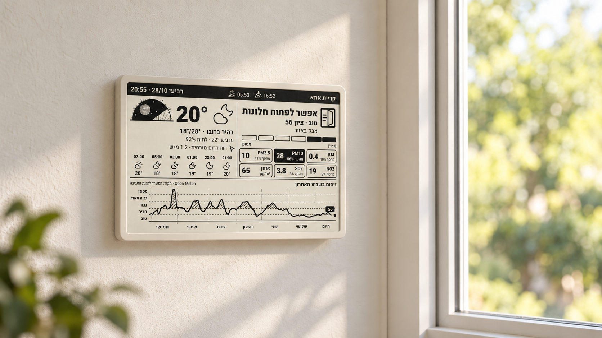

# Air Watch

A Hebrew air-quality and weather dashboard for a 7.5-inch, 800 × 480 e-ink display. It estimates local air conditions from Israel's Ministry of Environmental Protection (MoEP) monitoring stations, combines them with wind, and suggests when to open or close windows.



The room image is a presentation mockup. Its populated weekly graph comes from real MoEP readings captured on 28 October 2026, replayed at a synthetic regional location rather than a private home. [View the actual rendered dashboard](assets/portfolio/air-watch-screen.png). The renderer outputs a black-and-white panel PNG; the warm paper finish belongs to the presentation image.

## What you need

- [Bun](https://bun.sh/docs/installation) and Git. Tested with Bun 1.3.11.
- Internet access to the MoEP monitoring API and Open-Meteo.
- Your location's latitude and longitude, and suitable monitoring station IDs.
- Optional: an e-ink display or another consumer for the generated status JSON and PNG.

This version uses the **Israeli MoEP network**, Hebrew labels and `Asia/Jerusalem` time. It is not a worldwide station service. The optional industrial-source groups are specific to Haifa Bay. Locations outside Israel need a different monitoring-data adapter.

## 1. Install

```sh
git clone https://github.com/Natboa/air-watch-public.git
cd air-watch-public
bun install
```

Create your private configuration, **once**:

```sh
# macOS / Linux
cp .env.example .env
```

```powershell
# Windows PowerShell
Copy-Item .env.example .env
```

Do not overwrite an existing `.env` when updating. Bun loads `.env` automatically when you run commands from this directory; an extra dotenv package is unnecessary. For a scheduler running elsewhere, use an absolute `--env-file` path or change into the repository first. See [Bun's environment documentation](https://bun.sh/docs/runtime/environment-variables).

## 2. Add the coordinates of your address

Find your address in a map, select the exact map pin and copy its latitude and longitude. Verify the pin rather than relying on a street-name match. Enter decimal degrees in this order:

```dotenv
AIR_HOME_LAT=<your latitude, between -90 and 90>
AIR_HOME_LON=<your longitude, between -180 and 180>
AIR_PLACE="Your city"
```

Replace the angle-bracket placeholders with numbers; do not copy them literally. `AIR_PLACE` is optional: use a city or a generic label, never your street address. Its default is `איכות האוויר`.

**A street address is not accepted directly by the runtime.** Resolve it to coordinates once using your map or an agent following [the agent setup guide](docs/AGENT-SETUP.md). No address or geocoding API key needs to be stored here. Your coordinates are sent to Open-Meteo for forecasts; the optional dashboard basemap requests a surrounding area from OpenStreetMap's Overpass service. They stay out of Git, but are not confined to your computer.

## 3. Find stations near you

After setting the two coordinates, run:

```sh
bun run stations
# For an agent or another tool:
bun run stations --json
```

This authenticates as a guest, lists the **12 closest active stations** by geographic distance, and checks their recent samples. You do not need station IDs yet for this command. The output includes each station's ID, name, distance, mobile flag, newest reading age, and number of samples per observed channel. Keep this output private: distances from public stations can reveal your location.

Choose stations deliberately:

1. For **local air**, select nearby stations within `AIR_LOCAL_RADIUS_KM` (default 3 km), with useful pollutant coverage. The engine requires at least six readings for a pollutant in the latest available hour and a newest reading no older than 45 minutes. A station marked active can still be silent.
2. For **wind**, select stations with both `WD` (direction) and `WS` (speed). List the preferred station first; later entries are fallbacks. Leave empty to use the Open-Meteo wind forecast.
3. For **industrial sources**, use stations monitoring the source, not simply the stations closest to your house. These groups only make sense for the named Haifa Bay sources. Leave them empty elsewhere.
4. If no local station is close enough or fresh enough, the result is **unknown**, not good air. Do not silently increase the radius just to obtain a result.

You can also inspect stations on the [official MoEP map](https://air.sviva.gov.il). The helper reports observed channels; channel counts alone do not guarantee representative coverage or simultaneous valid WD/WS pairs.

### The real stations behind the example

The included tests and regional preview use real MoEP station identifiers. They illustrate three different roles: measuring nearby air, observing wind, and watching an industrial source. These are public station locations, not sensors installed at a user's home.

| Station ID | Station / area | Example role |
| --- | --- | --- |
| `602` | Mobile 9 (`ניידת 9`) | Nearby pollutant readings; its position can change |
| `88` | City Center, Kiryat Ata (`מרכז העיר`) | Nearby pollutants and measured wind |
| `97` | Kiryat Binyamin (`קריית בנימין`) | Nearby pollutants and a wind fallback |
| `322`, `517` | Mobile 4 / Nahal Kishon area | Sentinel readings around the refinery area |
| `415`, `594` | Bazan monitoring stations | Refinery source/fence coverage, when reporting |
| `499` | Western Kiryat Haim | Sentinel readings relevant to the tank-farm area |
| `627`, `628`, `629` | Tashan tank-farm stations | Source coverage, when reporting |

Some stations are mobile, some channels are missing, and a listed station can stop reporting. Discover current positions and actual channel availability with `bun run stations`; do not copy this table into your configuration without checking relevance and freshness. Source stations are useful for an incoming-plume estimate, while local stations are weighted by distance to the configured target.

## 4. Save every station group in `.env`

```dotenv
# Required: your selected local station IDs, comma-separated.
AIR_LOCAL_STATION_IDS=<local station IDs>
AIR_LOCAL_RADIUS_KM=3

# Optional: wind stations, in priority order.
AIR_WIND_STATION_IDS=

# Optional: Haifa Bay refinery and tank-farm source stations.
# An empty list disables the associated source warning.
AIR_BAZAN_STATION_IDS=
AIR_TASHAN_STATION_IDS=
```

Use actual positive integer IDs, without angle brackets. The code contains no deployment's default home or default station selection. Do not put an industrial fence station in the local-air list merely because its pollutant reading is high.

| Variable | Required? | Purpose |
| --- | --- | --- |
| `AIR_HOME_LAT`, `AIR_HOME_LON` | Yes | Private target coordinates |
| `AIR_LOCAL_STATION_IDS` | Yes | Stations used for nearby-air measurements |
| `AIR_PLACE` | No | Generic dashboard label or city |
| `AIR_LOCAL_RADIUS_KM` | No; default `3` | Maximum distance for local stations; must be positive |
| `AIR_WIND_STATION_IDS` | No | Ordered wind station candidates; empty uses forecast |
| `AIR_BAZAN_STATION_IDS` | No | Refinery sentinel/fence stations; empty disables the group |
| `AIR_TASHAN_STATION_IDS` | No | Tank-farm sentinel/fence stations; empty disables the group |
| `AIR_DIR` | No; default `data/` | Runtime status, state, history and alert files for the check/weekly commands |

## 5. API access

No personal API account or API key is required by the current clients:

| Service | Use | Authentication |
| --- | --- | --- |
| MoEP: `air.sviva.gov.il` and `air-papi.sviva.gov.il/v1` | Stations and measured pollutant/wind samples | The client obtains a temporary guest token/cookie automatically on each run |
| Open-Meteo: `api.open-meteo.com` | Forecast wind and dashboard weather | The implemented client uses the keyless endpoint |
| OpenStreetMap Overpass | Optional station-map basemap | No key in this implementation; downloaded map data is cached under `data/map/` |

Guest tokens are kept in memory. You do not need to copy a browser token into `.env`. The API URLs and request headers live in `src/sviva.ts`, `src/wind.ts`, `src/weather.ts` and `src/basemap.ts`; using another provider requires a data-adapter change. These services' availability and access policies can change independently of this project.

## 6. Verify and run

```sh
bun test
bun run check                         # live dry run: does not write status/history
bun run air-check.ts                  # one real run; creates data/ files
bun run air-check.ts --status         # last saved status, no network
bun run air-check.ts --stations       # raw recent measurements for all configured groups
bun run air-check.ts --alerts 5       # saved alert history
```

Tests use the committed `.env.test` with a synthetic location and public station fixtures. Your private location is unnecessary for running the suite.

The check prints alert text or `NOTHING_TO_REPORT`. It writes `air-status.json`, `air-state.json`, `history.jsonl` and, when appropriate, `air-alerts.jsonl` under `AIR_DIR` or `data/`. The JSON is the interface for another app, a bot, or a display. This repository does **not** send Telegram messages or include bot credentials.

## 7. Preview the e-ink dashboard

First make one real run so that `data/air-status.json` exists. Then:

```sh
bun run scripts/dashboard-demo.ts --out data/dashboard.png
# Optional simulated device indicators; 2-bit output is for compatible firmware:
bun run scripts/dashboard-demo.ts --device 87,-61 --bits 2 --out data/dashboard-4gray.png
```

The command writes PNG and SVG files, fetches current weather and station positions, and tries to load a basemap. A new installation may have no history yet: the graph starts empty and fills as checks run. If weather or map requests fail, those parts degrade gracefully. `--status <path>` and `--history <path>` select other input files; use them if your checks write to a custom `AIR_DIR`.

The panel format is 800 × 480, 1-bit black/white by default, with optional 2-bit greyscale. The hardware transport, device polling endpoint and firmware setup are **not included**. You can inspect the PNG on any computer before connecting hardware. Do not publish a real home-position map; use a synthetic location and sample data for public previews.

## 8. Run every five minutes

Each invocation runs once. Use your operating system's scheduler for repetition. For example, a Linux/macOS cron entry:

```cron
*/5 * * * * cd /absolute/path/to/air-watch && /absolute/path/to/bun run air-check.ts >> data/air-check.log 2>&1
```

Run the check manually first to create `data/`. Replace both paths with yours; use `command -v bun` to locate Bun. On Windows Task Scheduler, set the program to your Bun executable, arguments to `run air-check.ts`, the working directory to this repository, and repeat every five minutes. Keep scheduler logs private.

An optional `air-weekly.ts` command renders a weekly chart and prints its Hebrew caption. Schedule it separately if wanted. It exits with code `3` until there are at least 72 covered hours. Neither the scheduler nor message delivery is installed by these commands.

## Privacy and publishing

`.env`, other private `.env.*` files, `data/`, `.air-cache/` and `.private/` are ignored. Only `.env.example` and the synthetic `.env.test` should be committed. Never commit addresses, exact residential coordinates, real home-map screenshots, tokens, alert/history files or server-specific deployment details.

Adding a file to `.gitignore` does not remove earlier commits. Before making an existing repository public, inspect **its full history and commit metadata**, plus branches, tags, releases, issues and Actions artifacts. A fresh public repository from the cleaned files is safer than making a private repository's old history public. Keep the private deployment and configuration separately.

## Troubleshooting and limits

- **`Set AIR_...` at startup:** fill that variable in `.env`; coordinates and local stations are required. Run from the repository directory or pass the correct `--env-file`.
- **No stations or all readings stale:** check the official map, station mobility and candidate coverage. Try later if the provider is unavailable; do not treat missing data as clean air.
- **401/403 or API errors:** the MoEP client retries a transient 401 once. Persistent failures may be a service or protocol change; do not paste private browser cookies into a public issue.
- **Unexpected location:** latitude comes first, longitude second. Confirm the map pin. A new target also needs suitable station lists.
- **No history or blank graph:** make real checks repeatedly; `--dry-run` deliberately writes nothing.
- **Estimate limits:** nearby stations are not a sensor at your window. Calm air, coverage gaps and local plumes can weaken the estimate. The fixed industrial dilution was calibrated for one region and is not a universal dispersion model. The score compares one-hour readings with project-selected reference values; it is not the official MoEP index.

More detail: [how the estimate works](docs/HOW-IT-WORKS.md). For assisted onboarding, give your agent [these setup instructions](docs/AGENT-SETUP.md).
